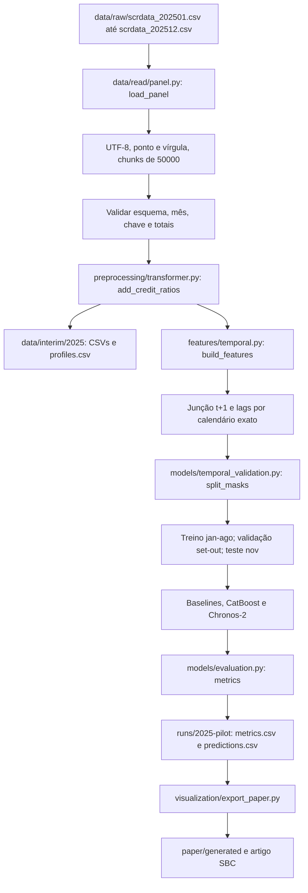
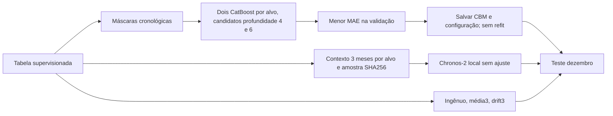
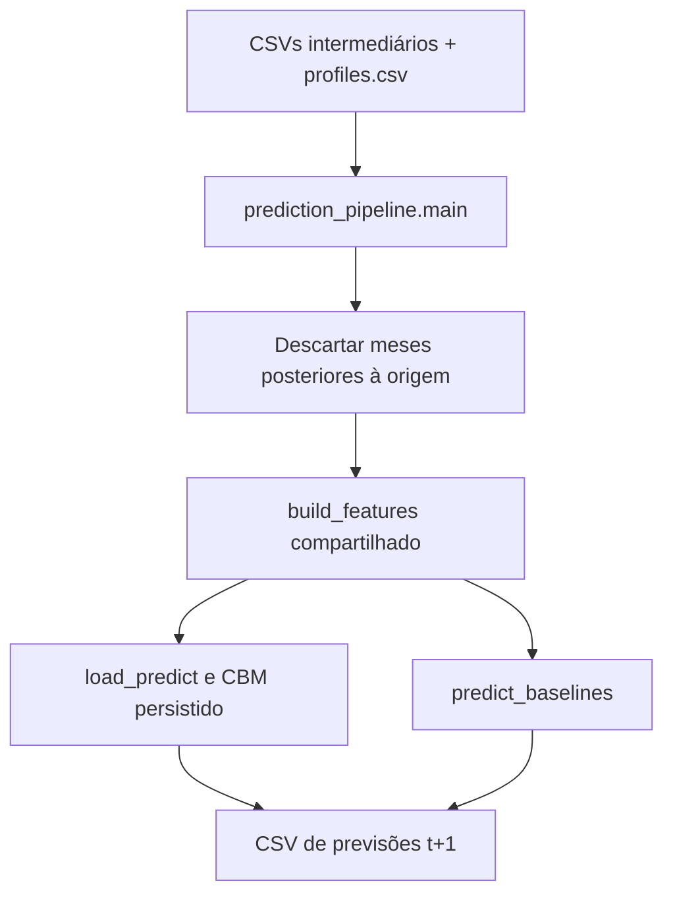
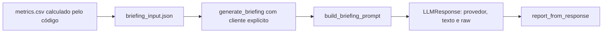

# Funcionamento do projeto entregue

O fluxo implementado é um experimento de regressão temporal para SCR.data 2025, com CatBoost supervisionado, Chronos-2 zero-shot e referências temporais. O protocolo e os limites científicos estão em [protocolo-catboost-chronos2.md](protocolo-catboost-chronos2.md). Resultados executados, e não apenas interfaces disponíveis, devem ser conferidos no manifesto e no relatório de execução.

## Do CSV à avaliação



Todos os caminhos dos blocos Python são relativos a `src/`. `pipelines/experiment.py:run` compõe as etapas; `pipelines/training_pipeline.py` é uma entrada alternativa para o mesmo fluxo. Não há LLM na previsão numérica.

## Arquivos, bibliotecas e transformações

| Etapa | Responsável real | Entrada → saída | Biblioteca/papel |
|---|---|---|---|
| Configuração | `src/config/settings.py:get_settings`, `constants.py` | ambiente e constantes → caminhos/nomes oficiais | pathlib, dataclasses |
| Leitura estrita | `src/data/read/panel.py:load_panel` | CSVs brutos → painel, auditoria e categorias | pandas/chunks, hashlib/SHA256 |
| Leitura simples | `src/data/read/csv_reader.py:CSVReader` | CSVs com decimal vírgula → DataFrames | pandas; não é a ingestão estrita experimental |
| Validação | `src/data/validation/data_validator.py` e `panel_validator.py` | esquema, mês e chave → erro explícito ou máscara de perfis | pandas, regras de domínio |
| Razões | `src/data/preprocessing/transformer.py:add_credit_ratios` | três saldos → duas proporções | pandas e NumPy para máscaras finitas |
| Atributos e rótulos | `src/features/temporal.py:build_features` | painel mensal → tabela supervisionada | pandas PeriodIndex e merge |
| Cortes | `src/models/temporal_validation.py:split_masks` | meses de origem → máscaras | comparações cronológicas ISO |
| Referências | `src/models/baselines.py:predict_baselines` | corrente/lag1/lag2 → três previsões | operações vetoriais |
| CatBoost | `src/models/catboost_regression.py:train_target`, `model_inputs` | treino/validação → CBM, JSON e previsões | CatBoostRegressor, NumPy |
| Chronos | `src/models/chronos_forecast.py:ChronosForecaster`, `pilot_mask` | contexto 3×1 por alvo → mediana t+1 | chronos, PyTorch, SHA256 |
| Avaliação | `src/models/evaluation.py:metrics` | observados e previsões alinhadas → métricas | NumPy, sem cálculo por LLM |
| Visualização | `src/visualization/experiment.py:plot_metrics` | metrics.csv → gráfico de MAE | matplotlib em backend Agg |
| Exportação | `src/visualization/export_paper.py:export` | execução concluída → TeX, figura, CSV e manifestos | pandas, shutil |
| Auditoria complementar | `src/analysis/panel_audit.py:audit_prepared` | tabela supervisionada em chunks → lacunas, contagens e mudanças de categorias | pandas, JSON |
| Reavaliação | `src/pipelines/evaluation_pipeline.py:evaluate_saved` | previsões e perfis salvos → métricas e briefing, sem treino | `models.evaluation.evaluate_table` compartilhado |
| Piloto isolado | `src/pipelines/chronos_pipeline.py:run` | painel preparado filtrado por chave → Chronos e baselines | mesmo preditor e avaliação do experimento |
| Briefing | `src/services/ia/briefing.py:generate_briefing` | números calculados → LLMResponse | contrato injetável e clientes REST existentes |

### Leitura e elegibilidade

Os CSVs ficam em `data/raw/`, e não em `src/`. O comando aceita `--raw` ou `DATA_RAW_DIR`. O intermediário é configurável por `--interim`. Não se alteram arquivos originais. O esquema real tem 24 campos, dos quais nove formam o perfil. `origem` e `indexador` não são descartados. O painel completo é consolidado depois da leitura em chunks para as junções; a modelagem ainda requer memória proporcional ao painel. Esta implementação não é um motor de execução totalmente fora de memória.

As categorias mantêm texto e espaços do original. Não há normalização de nomes, somente conversão técnica de vírgula decimal em ponto para `to_numeric`, e data de fechamento em mês ISO. Codificação UTF-8 é validada pela leitura estrita; uma codificação incompatível causa erro, não substituição silenciosa. Chave vazia é excluída e contada; total explícito e chave duplicada abortam a ingestão para revisão. Não há somas entre níveis de agregação. Se futuramente agregados forem necessários, é obrigatório somar saldos antes da divisão.

Trecho real de `add_credit_ratios`:

```python
active = active.where(np.isfinite(active) & (active > 0))
```

Isso torna denominador zero, negativo ou infinito ausente. Numeradores fora dos limites também são mascarados. As linhas permanecem no painel; o rótulo inválido é excluído somente da métrica/ajuste daquele target. `data_audit.json` registra contagens por arquivo. Categorias especiais são preservadas e códigos de número de operações não viram saldo.

Exemplo **sintético, usado no teste**: carteira ativa `10,0`, inadimplência `2,0`, problemático `3,0` produz proporções `0.2` e `0.3`. Ativa `0` produz ausente. Estes números explicam o contrato, não são resultados dos CSVs reais.

### Calendário e informação disponível

Trechos reais de `build_features`:

```python
result["target_month"] = (pd.PeriodIndex(result.month, freq="M") + 1).astype(str)
result = result.merge(labels, on=["series_id", "target_month"], how="left", validate="one_to_one")
```

`series_id` referencia a chave completa salva em `profiles.csv`. O rótulo pertence ao mesmo perfil no mês seguinte exato. Exemplo sintético: janeiro→fevereiro é válido; fevereiro→abril não é associado quando março falta. Lags usam junções equivalentes com deslocamento de calendário, sem atravessar perfis. A média3 só existe com corrente, lag1 e lag2 válidos. Não há preenchimento futuro.

Origens jan–ago treinam targets fev–set; set–out validam targets out–nov; novembro testa dezembro. CatBoost não é reajustado com validação. Histórico observado em outubro pode ser entrada da origem outubro, mas seu rótulo novembro não ajusta pesos. Janeiro tem histórico curto; média3, drift3 e Chronos precisam de março em diante. Doze meses não permitem baseline sazonal12. Perfis novos podem receber CatBoost, mas métodos de janela se abstêm; ausentes na origem não são previstos.

A avaliação usa data-base, não publicação histórica. O atraso oficial é aproximadamente 30 dias, e podem existir revisões. Data de extração local desconhecida; hashes e mtime ficam no manifesto de dados. Essa distinção impede tratar os números como desempenho operacional garantido.

## Treinamento e inferência



`train_target` ajusta dois modelos independentes. A decisão evita exigir simultaneamente dois rótulos válidos. Categóricas são strings com `__MISSING__`; numéricos usam NaN e CatBoost `nan_mode=Min`. São 200 iterações, semente 42, taxa 0,05, MAE, quatro threads; somente profundidade é selecionada na validação. Salva-se a configuração efetiva e o número de linhas de treino. Modelos e versão são auditáveis; isso é treinamento supervisionado, não pré-treinamento de modelo fundacional.

Chronos usa `amazon/chronos-2` e revisão fixa documentada no protocolo. Faz duas previsões univariadas de horizonte um com três meses contíguos; usa quantil 0,5 e `cross_learning=False`. Não recebe categorias nem saldos: essa diferença de entradas é uma limitação comparativa. Execução CPU é amostrada por chave (SHA256 módulo 1024); o escopo comum avalia os mesmos perfis de todos os métodos. Fine-tuning não está implementado nem foi executado. Não há dados simulados nas saídas reais.



Inferência em lote do CatBoost reutiliza `model_inputs` e `build_features`, não uma cópia das transformações. A integração Chronos existe no experimento, mas a CLI de inferência persistida é de CatBoost e baselines. Para dezembro→janeiro/2026 a CLI produz previsões sem rótulos futuros; isso não é avaliação com dados de 2026.

## Comandos reais (PowerShell, raiz do repositório)

Sem Python instalado no sistema, `scripts/bootstrap.ps1` baixa Python portátil 3.14.0 dentro de `.tools/` e cria `.venv/`. O bootstrap precisa de rede; não instala bibliotecas no sistema. `.tools/`, `.venv/` e `runs/` são ignorados. O primeiro download usa a versão corrente do uv; o Python e as dependências diretas são fixados.

```powershell
.\scripts\bootstrap.ps1
$env:PYTHONPATH = 'src'
.\.venv\Scripts\python.exe -m pip check
.\.venv\Scripts\python.exe -m compileall -q src
.\.venv\Scripts\python.exe -m unittest discover -s tests -v
.\.venv\Scripts\python.exe -m pipelines.experiment --output runs/2025-pilot
```

O diretório de saída deve ser novo; a execução não sobrescreve resultados anteriores. Para mudar caminhos e executar apenas baselines:

```powershell
.\.venv\Scripts\python.exe -m pipelines.experiment --raw data/raw --interim data/interim/2025 --output runs/baselines --models baselines
```

Para executar só o piloto Chronos sobre intermediários existentes, auditar lacunas ou recalcular métricas salvas:

```powershell
.\.venv\Scripts\python.exe -m pipelines.chronos_pipeline --output runs/chronos-pilot
.\.venv\Scripts\python.exe -m analysis.panel_audit --prepared data/interim/2025/supervised.csv --output runs/2025-pilot/panel_audit.json
.\.venv\Scripts\python.exe -m pipelines.evaluation_pipeline runs/2025-pilot
```

O piloto isolado lê `profiles.csv`, seleciona as chaves antes de consultar targets e filtra o painel em chunks. Sua cobertura é relativa à amostra; o experimento completo registra cobertura também sobre todo o conjunto elegível. Para Chronos integral use `--chronos-sample-modulus 1` no experimento, ou `--modulus 1` no piloto isolado. A execução integral não foi realizada nesta rodada. O corpus de pré-treinamento não foi auditado quanto à presença do SCR, limitação adicional da comparação retrospectiva.

O experimento tenta baixar checkpoint público caso não exista `.tools/chronos-2/model.safetensors`. O download não envia CSVs; inferência é local. Bloqueios de importação, rede e execução são registrados como `blocked`, sem substituir por previsão sintética. A execução continua com os métodos disponíveis; o conjunto `common` considera apenas métodos efetivamente executados. Confira o manifesto antes de chamar a tabela de comparação completa.

```powershell
.\.venv\Scripts\python.exe -m pipelines.prediction_pipeline --models runs/2025-pilot/models --origin 2025-11 --output runs/inference-nov.csv
.\.venv\Scripts\python.exe -m visualization.export_paper runs/2025-pilot
Push-Location paper
tectonic -k --keep-logs main.tex
Pop-Location
```

`paper/template/` foi preservado. O artigo usa o `.sty` SBC local e `template/sbc.bst`, resumo português e abstract inglês. Autores confirmados pelo usuário: João Alves Passos e Túlio Kenji Yoshimura. Afiliação e e-mails não foram informados e não foram inventados. O PDF precisa de revisão visual após a última compilação. Ferramentas/caches LaTeX podem precisar de acesso à rede.

## Métricas, resultados e briefing

`runs/2025-pilot/metrics.csv` contém `split`, `scope`, `target`, `model`, `n_eligible`, `n`, `coverage`, MAE/RMSE em proporção e pp, R² e previsões fora de [0,1]. `scope=available` mede cobertura sobre todos os rótulos válidos do período. `scope=common` restringe à interseção dos métodos executados; cobertura ali é condicional e não substitui a cobertura total. Há também recortes por mês, UF, cliente e segmento. `predictions.csv` preserva identificação, origem, mês alvo, observado e cada previsão; não há clipping.

R² é nulo com menos de duas observações ou target constante. Uma métrica sem amostras também é nula. Os testes verificam fórmulas com exemplos pequenos. `visualization/experiment.py` gera o gráfico apenas da tabela numérica. O exportador gera a tabela TeX e copia evidências pequenas para `paper/generated/`, sem publicar previsões por perfil, modelos ou CSVs brutos.



Trecho real da camada existente:

```python
prompt = build_briefing_prompt(str(metrics))
return client.generate(prompt)
```

O cliente é configurável e injetável. Os testes usam substitutos, não provedores reais. O experimento exporta `briefing_input.json`, mas **não chama** o LLM. Integração de texto depende de credenciais locais e ação explícita para envio; métricas e dados confidenciais não são enviados nesta execução. Serviços de LLM não calculam proporções, estatística ou previsões.

## Implementado, executado e pendente

Implementados: ingestão estrita, proporções, painel por calendário, atributos, cortes, baselines, treinamento/recarga CatBoost, integração zero-shot Chronos, avaliação/cobertura, exportação científica, inferência CatBoost e pacote de briefing. Execute os testes para verificar o contrato em dados sintéticos.

O relatório `docs/resultados-execucao.md` e `paper/generated/manifest.json` identificam o que efetivamente terminou. Fine-tuning, backtesting adicional, pico de memória, avaliação por vintages e validação externa estão pendentes. Não há baseline sazonal12 elegível nem prova de generalização robusta. A disponibilidade do Docker foi verificada separadamente: CLI encontrada fora do PATH; engine inicialmente indisponível. Isso não impede a execução no `.venv` solicitado.

### Campos adicionais de auditoria das previsões

Na reavaliação, `n_predictions` conta previsões finitas, inclusive quando o target seguinte não está disponível; `out_of_range` conta valores fora de [0,1] entre pares avaliáveis, e `out_of_range_all` também inclui previsões sem rótulo. Essas últimas não entram no MAE. `scope=month=2025-11` identifica a **origem** novembro, com target dezembro. As métricas dão o mesmo peso a cada perfil, sem ponderação por carteira. `src/data/validation/panel_validator.py` concentra integridade de mês, totais e unicidade, compondo a ingestão estrita; transformações numéricas continuam em `preprocessing/`.


## Execução final consolidada

A evidência final é `runs/2025-comparison`, derivada de `runs/2025-pilot` (CatBoost e baselines completos) e `runs/chronos-pilot` (Chronos local amostrado). `src/pipelines/merge_forecasts.py:merge_runs` confere SHA256 de `profiles.csv`, rejeita duplicatas/sobrescrita do modelo, faz junção exata por `series_id`, `month`, `target_month`, `target` e chama a avaliação compartilhada. As execuções originais são preservadas. Essa consolidação foi necessária porque a execução inicial já iniciada tentou checkpoint remoto e teve bloqueio de rede; a versão final do experimento prefere o checkpoint local disponível. Use `python -m pipelines.merge_forecasts runs/2025-pilot runs/chronos-pilot --output runs/2025-comparison` e exporte esse diretório para o artigo. O comando de uma execução nova do fluxo completo permanece válido.

CatBoost: dois modelos treinados e avaliados. Chronos: zero-shot local executado em amostra determinística; sem fine-tuning e sem avaliação integral. Tabelas/figura do artigo vêm de `runs/2025-comparison/metrics.csv`. O briefing continua sem chamada real. Consulte o relatório de execução para números e custos, inclusive previsões fora do intervalo preservadas.
